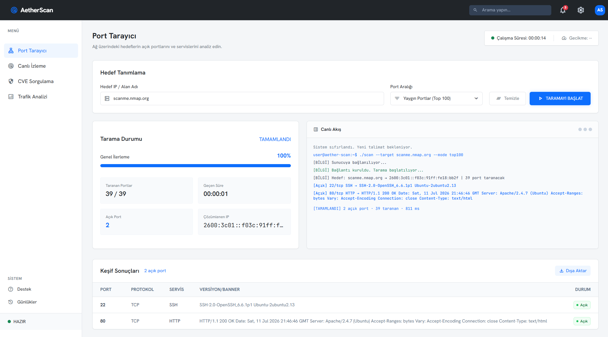
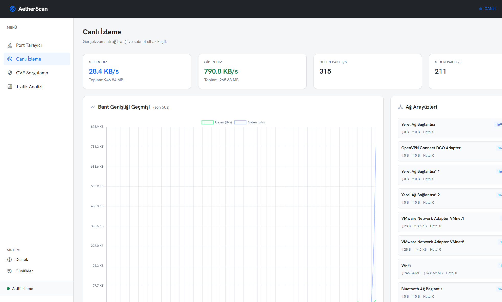
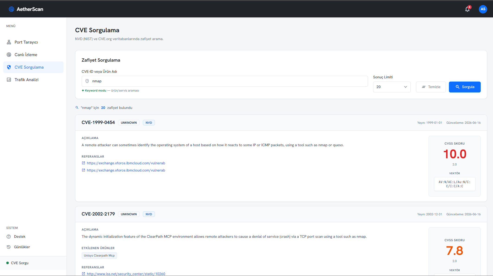
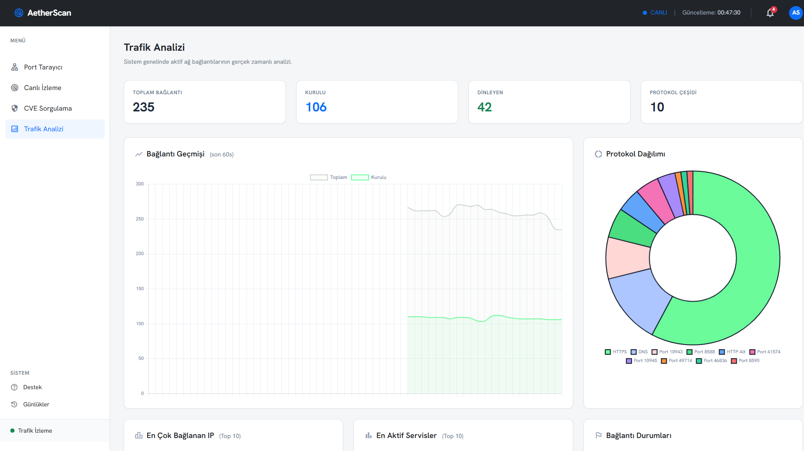

# AetherScan

A personal cybersecurity dashboard for network reconnaissance and vulnerability research. Built with a FastAPI backend and a clean, modern enterprise-grade browser frontend, it combines port scanning, live traffic monitoring, CVE lookups, and connection analysis in a single interface.

## Screenshots

| Port Scanner | Live Monitor |
|---|---|
|  |  |

| CVE Lookup | Traffic Analysis |
|---|---|
|  |  |

## Features

**Port Scanner** — Async TCP connect scan with WebSocket live streaming. Supports stealth, default, and aggressive scan profiles backed by `asyncio.Semaphore` concurrency control. Resolves hostnames, grabs banners, and exports results to CSV.

**Live Monitor** — Real-time bandwidth charts (bytes/s, packets/s) powered by `psutil`. Lists all active network interfaces with per-interface I/O stats updated every second via WebSocket.

**CVE Lookup** — Queries the NVD API v2.0 and CVE.org. Supports direct CVE-ID lookup and keyword search. Displays CVSS scores, severity, affected products, and references. High-severity results trigger in-app notifications.

**Traffic Analysis** — Monitors active TCP/UDP connections system-wide. Tracks connection state distribution (ESTABLISHED, LISTEN, etc.), protocol breakdown, and 60-second history chart.

**Logs** — Scan history from SQLite and in-memory system event log (last 500 entries). Filterable by level: INFO / WARN / ERROR.

**Settings** — Scan profile switcher (Stealth / Default / Aggressive / Custom) with configurable timeout and concurrency.

## Tech Stack

| Layer | Technology |
|---|---|
| Backend | Python 3.11, FastAPI, Uvicorn |
| Async I/O | asyncio, asyncio.Semaphore |
| System Metrics | psutil |
| Database | SQLite (sqlite3) |
| Vulnerability Data | NVD API v2.0, CVE.org |
| Frontend | Tailwind CSS, Chart.js |
| Real-time | WebSocket |
| Fonts | JetBrains Mono, Hanken Grotesk, Material Symbols |

## Getting Started

```powershell
# Create and activate virtual environment
python -m venv venv
.\venv\Scripts\Activate.ps1

# Install dependencies
pip install -r requirements.txt

# Start the server
uvicorn app.main:app --port 8080 --reload
```

Open `http://localhost:8080`.

By default the scanner restricts targets to localhost, private ranges, and `scanme.nmap.org`. To allow public targets for authorized testing:

```powershell
$env:SCANNER_ALLOW_PUBLIC="1"
uvicorn app.main:app --port 8080 --reload
```

## Project Structure

```
ag dashboard/
├── app/
│   ├── main.py          # FastAPI app, endpoints, WebSocket handlers
│   ├── scanner.py       # Async port scanner
│   ├── database.py      # SQLite scan history
│   └── run_scanner.py
├── static/
│   ├── index.html      
│   ├── monitor.html   
│   ├── cve.html         
│   ├── traffic.html     
│   ├── logs.html       
│   ├── support.html     
│   └── notifications.js
├── docs/screenshots/
├── requirements.txt
└── README.md
```

## Notes

- Designed for personal security research and authorized network testing only.
- The NVD API may rate-limit requests; avoid rapid successive queries without an API key.

---

Developed by [Sena](https://github.com/themlie) — [LinkedIn](https://www.linkedin.com/in/sena-sahin/)
